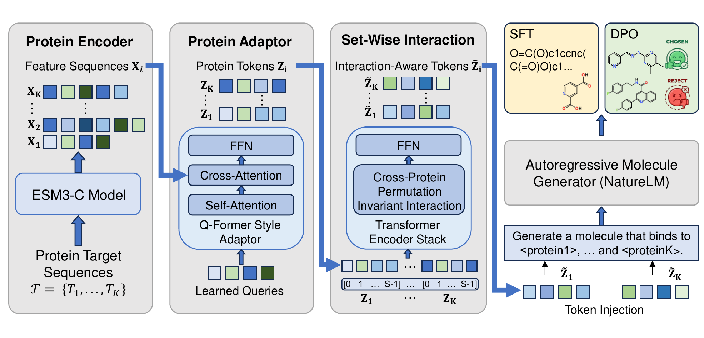

# PolyTamGen

Official implementation of [Polypharmacological Target-Aware Molecule
Generation](https://doi.org/10.1093/bioinformatics/btag766)
(*Bioinformatics*, 2026).

[Paper](https://doi.org/10.1093/bioinformatics/btag766) ·
[Data, models, and results](https://doi.org/10.5281/zenodo.23417382) ·
[Reproducibility guide](REPRODUCIBILITY.md)

PolyTamGen generates molecules conditioned on two or more protein targets.
ESM-C 600M encodes the protein sequences. An attention module compresses their
features into tokens, and an autoregressive model uses those tokens to generate
a ligand.
Training uses supervised fine-tuning (SFT), followed by Direct Preference
Optimization (DPO) with docking-based affinity proxies and drug-likeness.

This repository includes the source code, lightweight metadata, and download
instructions for the released training and benchmark assets. You can train
PolyTamGen with SFT and DPO, run the dual-target (T2) and triple-target (T3)
generation benchmarks, or recompute analyses from the archived results.



Model overview from the paper. Protein tokens interact across targets before
they condition NatureLM. [View the original PDF](docs/images/framework.pdf).
The figure labels the protein encoder as ESM3; the released feature inputs use
ESM-C 600M.

## Repository contents

```text
source/pp2d/        Installable PolyTamGen package, configs, scripts, tests
results/            Download note for the external full-results archive
models/             Model archive notes; runtime model paths live under source/pp2d/models
data/               Data archive notes; runtime data paths live under source/pp2d/data
ASSETS.md           External archive layout and manifest notes
REPRODUCIBILITY.md  Release scope and archived-result reproduction guide
```

## Setup

Create and activate the Conda environment:

```bash
git clone https://github.com/bjzgcai/PolyTamGen.git
cd PolyTamGen/source/pp2d
conda create -y -n pp2d python=3.12
conda activate pp2d
```

Install PyTorch and PyTorch Geometric builds that match your CPU or CUDA
environment before running the dependency helper. Then, from
`source/pp2d/`, install the remaining dependencies and the package:

```bash
python -m pip install --upgrade pip setuptools wheel
PP2D_SKIP_CREATE=1 bash setup_env.sh
python -m pip install -e . --no-deps --no-build-isolation
```

Set `PP2D_INSTALL_TORCH_STACK=1` when invoking the helper only if the torch
packages in `requirements.txt` suit your environment. Each example below
assumes you start from the repository root.

## Model and data assets

Download the model, data, and result files from
[Zenodo record 23417382](https://zenodo.org/records/23417382)
(DOI: [10.5281/zenodo.23417382](https://doi.org/10.5281/zenodo.23417382)).
These large files are stored separately from Git. Put them under
`source/pp2d/`; the command examples run from that directory and use relative
paths such as `models/`, `data/`, and `results/`.

Use these paths for the models:

```text
source/pp2d/models/polytamgen-dpo/polytamgen-dpo.pth
source/pp2d/models/base-llm/NLM-1b
```

Download `polytamgen-dpo.pth` and place it under
`source/pp2d/models/polytamgen-dpo/`. Extract `base-llm_NLM-1b.tar` from
`source/pp2d/models/` so it creates `source/pp2d/models/base-llm/NLM-1b/`.

Download the four results volumes (`polytamgen_full_results.tar.xz.part01`
through `.part04`), then [assemble and extract them](ASSETS.md#where-to-extract)
so that `source/pp2d/results/` contains the scored T2/T3 metrics, raw generations,
supplementary outputs, figures, and analysis inputs. See `ASSETS.md` and
`ASSET_MANIFEST.csv` for the expected layout.

Put the processed datasets under `source/pp2d/data/`:

```text
sft_train_valid/       SFT training and validation profiles
pdb_multitarget/       T2/T3 benchmark inference profiles and pocket features
pdb_benchmark/         Benchmark TSVs, pocket sequences, and docking pockets
dpo_preferences/       Preference pairs used for DPO training
```

## Protein feature extraction

The released data already contain protein-feature LMDBs. Use those files for
the supplied training and benchmark profiles. For new targets, prepare the
features before running inference:

```text
Target amino-acid sequence
  -> frozen ESM-C 600M, one sequence per forward
  -> last block's hidden state, before final LayerNorm
  -> keep BOS + sequence tokens + EOS
  -> CPU float16 tensor [sequence_length + 2, 1152]
  -> pickle into LMDB under the profile's protein ID
  -> protein adapter -> target interaction -> NatureLM
```

Use `output.hidden_states[35, 0]` with `esm==3.2.1`. Keep all sequence tokens
and both special tokens; do not pool tokens or average layers.
`output.embeddings` is the output after final LayerNorm and gives a different
representation. The reference setup uses CUDA bfloat16 computation and float16
storage.

Choose the sequence explicitly. A pocket PDB contains only some residues, so
encoding its sequence gives different features from encoding the full chain.
When checking an archived feature, use the exact sequence associated with that
key. Protein IDs in the profile must match the UTF-8 LMDB keys exactly.
Inference reads these cached features; it does not extract them on the fly.

See [the extraction example](source/pp2d/README.md#protein-feature-extraction)
for sequence preparation, local encoding, file creation, and the reference
comparison. The generic `src/esm_feature_extractor.py` helper defaults to a
300M Forge model and mean pooling; those defaults do not produce the released
600M feature format.

## Paper results

The post-processing scripts and results bundle for version `2026.10.16` use
the revised main cutoff, `AvgDock < -8.18`, and rank-matched target-conditioning
outputs. The raw scores and generations are unchanged from the earlier release.

See [the reproducibility guide](REPRODUCIBILITY.md) for the required files
and reproduction commands.

## Inference

Generate a small sample with PolyTamGen-DPO on two T2 benchmark inputs:

```bash
cd source/pp2d
python scripts/inference.py \
  --config configs/polytamgen_dpo.yaml \
  --checkpoint models/polytamgen-dpo/polytamgen-dpo.pth \
  --test_data_path data/pdb_multitarget/T2/ligand_profiles.pkl \
  --split_path data/pdb_multitarget/T2/split.pkl \
  --lmdb_path data/pdb_multitarget/protein_features.lmdb \
  --split_key test \
  --output_dir outputs/inference/polytamgen-dpo-quick-check \
  --num_return_sequences 1 \
  --max_new_tokens 256 \
  --limit 2 \
  --batch_size 1
```

For full benchmark-scale generation, remove `--limit` and increase
`--num_return_sequences`. Keep sampling enabled and the generation limit at
`--max_new_tokens 256`, and choose a separate output directory for the full
run. More inference examples are in `source/pp2d/README.md`.

## Training

SFT training:

```bash
cd source/pp2d
python scripts/train_pp2d.py --config configs/polytamgen_sft.yaml
```

DPO training:

```bash
cd source/pp2d
python scripts/train_dpo.py --config configs/polytamgen_dpo.yaml
```

Add `--dry_run` to either command to run one training and one validation
micro-batch without saving checkpoints. This still loads the model and data.
To reduce the workload for a CPU run, add:

```text
--distributed false --batch_size 1 --num_workers 0 --train_subset true --train_subset_size 1 --valid_subset true --valid_subset_size 1
```

Build DPO preference pairs from the scored T2 results:

```bash
cd source/pp2d
python scripts/data/build_dpo_preferences.py \
  --input results/raw_generation/T2/PolyTamGen-SFT.json \
  --output data/dpo_preferences/preferences_5qed_train.jsonl \
  --valid-output data/dpo_preferences/preferences_5qed_valid.jsonl \
  --valid-fraction 0.2 \
  --qed-weight 5.0
```

The preference reward is:

```text
reward = -mean_active_vina + 5.0 * QED
```

Full DPO retraining starts from an SFT checkpoint produced by the SFT stage.

## Notes

- To rerun docking, you need the docking software stack and sufficient GPU or
  CPU compute. Use the released scored files as reference inputs when
  recomputing tables under the revised cutoff.
- The reproduction scripts recompute table values and available analysis
  figures from the released results.
- The model assets include the DPO checkpoint and base LLM. Download the data
  and result archives separately and keep the paths documented in `ASSETS.md`.

## Citation

If you use PolyTamGen in your research, please cite:

```bibtex
@article{wu2026polytamgen,
  author  = {Wu, Kehan and Zhang, Wei and Guo, Han and Liu, Renhe and
             Shi, Yu and Jin, Peiran and Liu, Haiguang and Chen, Enhong and
             Qin, Tao and Liu, Zequn and Xia, Yingce},
  title   = {Polypharmacological Target-Aware Molecule Generation},
  journal = {Bioinformatics},
  year    = {2026},
  pages   = {btag766},
  doi     = {10.1093/bioinformatics/btag766},
  url     = {https://doi.org/10.1093/bioinformatics/btag766}
}
```
